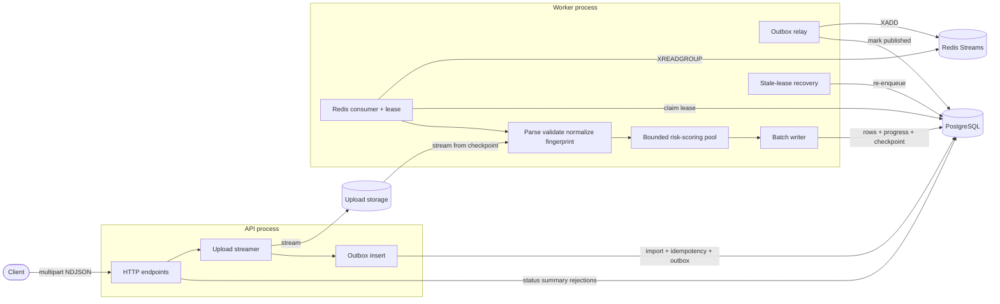
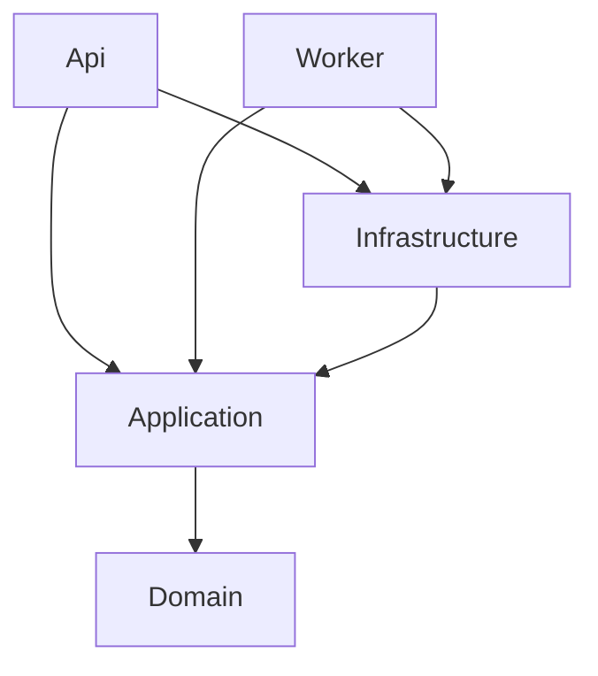

# Architecture

Production-oriented design for high-throughput NDJSON import: stream uploads, process
asynchronously under database leases, isolate CPU-heavy scoring from the API, and keep
correctness in PostgreSQL constraints.

## Components

API and Worker are separate processes from the same codebase ([ADR 0002](adr/0002-job-execution-model.md),
[ADR 0004](adr/0004-redis-streams-outbox.md)). The API never runs CPU-heavy work. The Worker exposes HTTP
only for health and metrics.

## Module boundaries and dependency direction

| Project | Responsibility | May depend on |
| --- | --- | --- |
| `Domain` | Import lifecycle, progress invariants, risk levels, rejection codes | nothing |
| `Application` | Use cases and ports | Domain |
| `Infrastructure` | Postgres, Redis, storage, scoring, OTel, DI registration | Application, Domain |
| `Api`, `Worker` | Composition roots | everything above |

`tests/.../Architecture/DependencyDirectionTests.cs` fails the build if Domain or Application reference
Infrastructure, hosts, Npgsql, or ASP.NET Core.

## Dependency injection

- Constructor injection only; no service locator or static mutable containers.
- Each host `Program.cs` is the composition root. Bindings live in
  `InfrastructureServiceCollectionExtensions.AddInfrastructure`.
- Time: BCL `TimeProvider`. Ids: `IIdGenerator` (UUIDv7). Options: `ValidateOnStart`.
- At least one unit test replaces production ports with fakes (`CreateImportHandlerTests`).

## Processing workflow

1. **Upload** — multipart body streams through `UploadInspectionStream` (size cap, content sniff, SHA-256)
   into `IFileStorage` (local / S3 / Cloudinary). Never buffer the whole file.
2. **Create** — one DB transaction writes idempotency reservation, import row (`pending`), and outbox message.
3. **Enqueue** — outbox relay `XADD`s to Redis Streams; workers `XREADGROUP` / `XAUTOCLAIM`.
4. **Claim** — worker takes a DB lease (`locked_by`, `lease_token`, `lease_expires_at`) and heartbeats.
5. **Parse** — `NdjsonLineReader` streams from the last byte checkpoint; overlong lines become one rejection.
6. **Validate / normalize** — per-line; invalid lines are rejected without aborting the import.
7. **Fingerprint + score** — SHA-256 fingerprint; risk score via a **bounded** thread pool (not unbounded tasks).
8. **Persist batch** — accepted rows, rejections, progress, checkpoint, and optional summary snapshot in **one**
   transaction, fenced by lease token.
9. **Complete** — status `completed` / `failed` / `cancelled`; Redis message `XACK`.

## Database consistency

- Unique `(provider_id, transaction_id)` on accepted transactions — durable duplicate protection.
- Unique idempotency keys per provider — concurrent same-key creates cannot double-insert.
- Check constraints: `processed = accepted + rejected`, lease only while processing/cancelling, etc.
- Batch commits use `ON CONFLICT` for idempotent re-delivery; delivery is **at-least-once**, results are
  **effectively-once** via constraints ([ADR 0003](adr/0003-record-outcome-semantics.md)).
- Status transitions are guarded: `UPDATE ... WHERE status = ANY(allowed_sources)`.

## Duplicate detection

A transaction is a duplicate when the same `transactionId` was already **accepted** for the same provider
(in-file, cross-file, cross-process, after restart). Same fingerprint → `DUPLICATE_TRANSACTION`; different
content → `DUPLICATE_CONFLICT`. An in-memory set is never the source of truth.

## Retry strategy

`ExponentialBackoffRetryPolicy` wraps transient infrastructure operations (DB serialization/deadlock,
Redis blips, timeouts, I/O):

| Setting | Default |
| --- | --- |
| Max attempts | 5 |
| Backoff | exponential + full jitter |
| Cap | 5 s |

**Never retried:** validation failures, duplicates, permanent constraint violations, cancellation,
programming errors (`AppException` with `Retryable=false`). After import-level attempt budget is exhausted,
status becomes `failed` with a reason; operators can `POST .../retry` to re-queue from the last checkpoint.

## Cancellation strategy

- `pending` → `cancelled` immediately (no further processing).
- `processing` → `cancelling`; worker stops at the **next batch boundary**, does not commit further batches,
  then confirms `cancelled`.
- Repeated cancel requests are idempotent. Cancelled jobs do not keep writing after confirmation.

## Graceful shutdown

On `ApplicationStopping`:

1. `/health/ready` becomes unhealthy (load balancers stop new traffic).
2. API stops accepting new meaningful work as Kestrel drains.
3. Worker stops claiming new jobs; in-flight batch either commits or the lease expires for recovery.
4. Risk-scoring pool and DB connections dispose within the host shutdown timeout (`stop_grace_period` in Compose).

If the grace period expires, the process exits; expired leases + stale recovery re-enqueue work. Shutdown is
**not** the same as cancel: shutdown releases for resume; cancel is a terminal customer intent.

## Backpressure and concurrency

| Limit | Config | At capacity |
| --- | --- | --- |
| Concurrent imports per worker | `Processing:MaxConcurrentImports` | Extra Redis messages wait; jobs stay `pending` |
| Prefetch / in-flight batches | `Processing:PrefetchBatches` | Parser waits on bounded channel |
| Risk-scoring queue | `RiskScoring:MaxQueuedRequests` | Score calls await / back-pressure into parser |
| Risk worker threads | `RiskScoring:WorkerCount` (0 → CPU count) | Fixed pool size |
| Upload size | `Imports:MaxFileBytes` | HTTP 413 |
| DB pool | Npgsql `Maximum Pool Size` | Callers wait / timeout (classified transient) |

There is no `records.Select(ProcessAsync)` fan-out. Overload surfaces as growing Redis lag, elevated
`batch_stage_duration_seconds`, and readiness still healthy until dependencies fail.

## Failure recovery

| Failure | Behavior |
| --- | --- |
| API crash mid-upload | Incomplete multipart; no import row (or orphaned temp cleaned on next deploy) |
| Worker crash mid-batch | Uncommitted batch rolls back; lease expires; recovery sets `pending` + outbox |
| Lost Redis notification | Recovery re-enqueues when `last_enqueued_at` is older than claim-idle window |
| Double delivery | Lease fence + unique constraints absorb overlap |
| Progress commit fails after rows | Same transaction — both roll back |

## Observability

- Structured JSON logs: request id, import id, worker id, stage durations, retry attempts (no full files /
  descriptions).
- Prometheus `/metrics`: HTTP (ASP.NET instrumentation), imports, records, uploads, retries, runtime
  (CPU/memory via `OpenTelemetry.Instrumentation.Runtime`). Low-cardinality labels only.
- Optional OTLP traces when `OTEL_EXPORTER_OTLP_ENDPOINT` is set.

## Runtime saturation (operator notes)

| Signal | Suggests |
| --- | --- |
| High `batch_stage_duration_seconds{stage=score}` + high process CPU | CPU saturation — lower `WorkFactor` or add workers |
| High stage duration + low CPU + DB waits | Downstream I/O / Postgres |
| Growing Redis stream lag, pending imports | Worker capacity — raise replicas or `MaxConcurrentImports` carefully |
| API P99 up, worker CPU high | Scoring isolation working; scale workers independently |
| Ready failing, live OK | Dependency outage — do not kill the process for DB blips |

Latency-sensitive endpoints only touch Postgres for reads/writes of metadata; they never score transactions.

## Security posture

File-size and body limits; ignore client MIME/filename for trust; path traversal blocked; parameterized SQL;
size-capped rejection payloads; no stack traces to clients. Auth is out of scope but `X-Provider-Id` is the
seam for a future principal.
