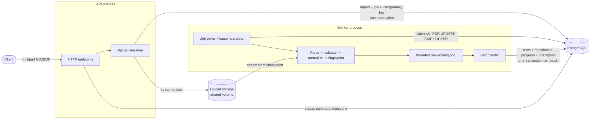
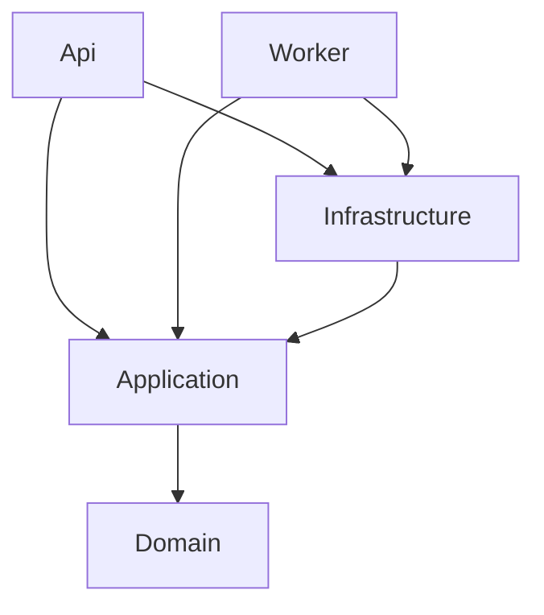
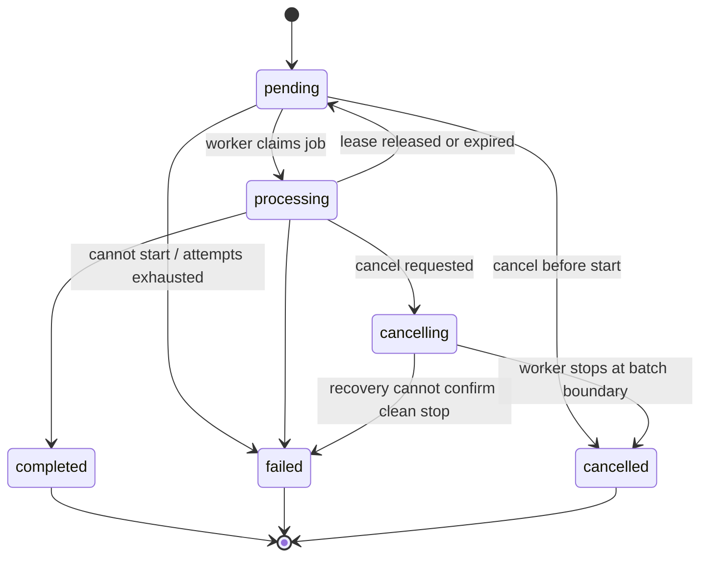

# Architecture

This document grows with the implementation. Sections describe what exists in the code. Design that is
decided but not yet implemented is marked **(design)**.

## Components

The API and Worker are separate processes built from the same codebase (ADR 0002). The API never runs
CPU-heavy work; the Worker exposes HTTP only for health checks and metrics.

## Module boundaries and dependency direction

| Project | Responsibility | May depend on |
| --- | --- | --- |
| `Domain` | Import lifecycle state machine, progress invariants, risk levels, rejection codes | nothing |
| `Application` | Use cases and ports (`IIdGenerator`, repositories, file storage, queue, scorer, ...) | Domain |
| `Infrastructure` | Npgsql data access, health checks, file storage, DI registration | Application, Domain |
| `Api`, `Worker` | Hosts and composition roots | everything above |

`tests/TransactionImport.UnitTests/Architecture/DependencyDirectionTests.cs` fails the build if Domain or
Application reference Infrastructure, either host, Npgsql or ASP.NET Core.

## Dependency injection

- Constructor injection only. There is no service locator and no static mutable state.
- Each host's `Program.cs` is its **composition root**. Infrastructure bindings are grouped in
  `InfrastructureServiceCollectionExtensions.AddInfrastructure`.
- Time comes from the BCL `TimeProvider` (replaced by `FakeTimeProvider` in tests). Ids come from
  `IIdGenerator` (UUIDv7, so B-tree inserts are append-mostly).
- Options are bound and validated at startup (`ValidateOnStart`), so misconfiguration fails fast.

## Import lifecycle

`ImportStatusTransitions` is the single source of truth. Persistence uses `AllowedSources(target)` to build
guarded updates (`UPDATE ... WHERE status = ANY(@allowed)`), so concurrent actors (worker, cancel endpoint,
stale-job recovery) cannot race into an invalid state.

## Health

- `GET /health/live` runs no dependency checks. A database outage must not make the orchestrator restart
  otherwise healthy processes.
- `GET /health/ready` checks PostgreSQL (3 s timeout) and the shutdown state. It turns unhealthy as soon as
  `ApplicationStopping` fires.
- Responses contain statuses only. Exception details stay in logs.

## Error handling

The API returns `{"error":{"code","message","requestId"}}`. `GlobalExceptionHandler` maps known exception
types to stable codes. Anything unknown is treated as a programming error: it is logged in full and
returned as `500 INTERNAL_ERROR` with no internal details. Request ids are generated by the server and
returned in `X-Request-Id`.

## Remaining sections

The following are documented as they are implemented: processing workflow, database consistency
strategy, retry strategy, cancellation strategy, graceful shutdown, duplicate detection (decided in
ADR 0003), backpressure, and failure recovery.
